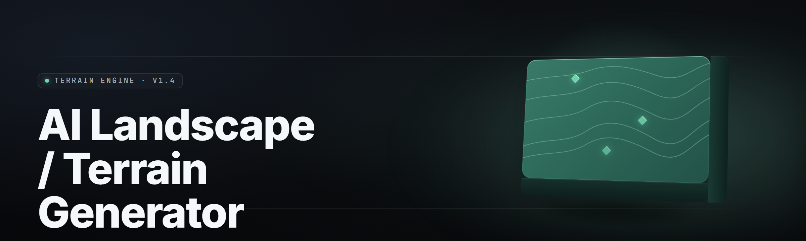

  
  
  

  

  
  
  

---

---

## 🧭 Overview

**ai-terrain-generator-studio** is a Windows desktop AI landscape and terrain generator for 2026 — diffusion-assisted heightfield synthesis, erosion simulation, biome painting, and one-click Unreal/Unity/Godot export. You drop a prompt, a brush, or a DEM file; the studio returns a production-ready terrain stack with layered maps, slope masks, and splat weights baked in.

No python. No node. No compile step on your end. Download, extract, double-click the `.exe`, and you're generating land in under ninety seconds.

| Category | Details |
|---|---|
| Product | AI Landscape / Terrain Generator (Studio build) |
| Release | 2026 · v2.4.1 stable channel |
| Core Engine | Hybrid latent diffusion + hydraulic/thermal erosion solver (GPU-accelerated) |
| Input Modes | Text prompt, heightmap import, brush stroke, reference image, DEM/SRTM tile |
| Output Formats | PNG16 heightmap, RAW `.r16`, OBJ/FBX mesh, Unreal Landscape, Unity Terrain, Godot HeightMap, glTF |
| GPU Requirement | Vulkan 1.3 or CUDA 12.x capable card (RTX 20-series / RX 6000-series or newer) |
| Default Seed Bank | 4,096 curated biome seeds + infinite prompt-space sampling |
| Distribution | Standalone `.exe` — extract-and-run, no installer required |

The studio was built for level designers, worldbuilders, mod authors, and hobbyists who want real terrain — not a tilemap shuffle. Under the hood a small latent model proposes macro topology (ridge lines, valleys, coastline bias), then a physics-informed erosion pass carves drainage, scree slopes, and sediment fans until the mesh reads like it fell out of the real world.

### Download

  

---

## 🗺️ What is ai-terrain-generator-studio — Term | Explanation

| Term | Explanation |
|---|---|
| **Heightfield** | A grayscale 16-bit image where pixel brightness equals elevation. The studio's canonical terrain format. |
| **Prompt-to-Terrain** | Text-conditioned latent sampling that produces a macro topology seed from a short description ("alpine lake, scree, dawn fog"). |
| **Erosion Pass** | GPU solver applying hydraulic + thermal erosion for N iterations to carve gullies, fans, and stable scree. |
| **Splat Map** | Per-channel weight mask (grass/rock/sand/snow) exported alongside the heightfield for engine material blending. |
| **Biome Stack** | Ordered list of biome layers, each with a climate rule set — dictates what grows where based on altitude, slope, moisture. |
| **Tile Stitch** | Seamless merge of adjacent terrain tiles into one continuous landscape via overlap diff-fade. |
| **Flow Map** | Vector field output showing water direction per cell — feeds river meshes, wetness masks, cart trails. |

Five reasons builders keep it open:

- Prompts land as *biologically plausible* terrain, not fractal noise soup.
- Erosion runs at interactive speed — you see the land age in front of you.
- Every export is engine-ready, alignment pre-solved (metres, up-axis, tiling origin).
- Works fully offline after the first-run asset unpack — no telemetry, no cloud dependency.
- One project file (`.atgs`) holds prompts, seeds, stack, and history — reproducible worlds.

---

## 🧱 Feature Categories — 19 Modules, First Pass

**1. Prompt Synthesis** — Latent text-to-topology conditioning with 4,096-token vocabulary tuned on real DEM tiles.
**2. Heightfield Brush** — Sculpt, smooth, terrace, gouge — pressure-aware, 32-bit float internal precision.
**3. Erosion Solver** — Hydraulic + thermal passes on GPU; adjustable rain rate, sediment capacity, talus angle.
**4. Biome Painter** — Altitude/slope/moisture rules with per-biome colour ramps and splat output.
**5. River & Lake Tool** — Flow-map solver picks basins, generates river splines, fills lakes to spill height.
**6. Cliff & Scree Gen** — Detects slope thresholds, applies rock scatter, produces breakdown talus.
**7. Coastal Shaper** — Sea-level sweep with tidal notching, wave-cut platforms, dune ridges.

## 🧱 Feature Categories — Second Pass

**8. Reference Conditioning** — Drop a photo, satellite shot, or concept art → studio matches ridgeline mass and value distribution.
**9. DEM Import** — SRTM, ASTER, and GeoTIFF ingest with automatic re-projection and unit normalisation.
**10. Seamless Tiling** — Wrap modes (tile / mirror / blend) for infinite-world streaming.
**11. Chunk Streamer** — Export 1×1 km → 32×32 km grids with LOD pyramid and edge-matched borders.
**12. Splat Weight Export** — Four-channel PNG or engine-native terrain layers, channels reorderable.
**13. PBR Map Bake** — Albedo, normal, roughness, AO, curvature — rendered from the heightfield in one click.
**14. Scatter Instancer** — Poisson-disc distribute rocks, trees, grass clumps; export as engine scatter or FBX points.

## 🧱 Feature Categories — Third Pass

**15. Erosion Preview Timeline** — Scrub through erosion iterations, snapshot any frame as the live heightfield.
**16. Macro Mask Composer** — Hand-paint coarse masks (desert/forest/snow) that bias every downstream pass.
**17. Mesh Decimator** — Collapse to engine budget (2k → 500k tris) with feature-preserving edge collapse.
**18. Batch Generator** — Queue 200 prompts overnight, land with a folder of named terrain kits.
**19. Preset Library** — 140+ curated world seeds (Iceland, Patagonia, Mars analogue, Tatooine, Hyrule-ish, alpine lacustrine).

---

## ✅ Feature Modules — Module | Status | Description

| Module | Status | Description |
|---|---|---|
| Prompt Synthesis | ✅ Working | Text → macro topology in 1–3 s on RTX 3060+ |
| Heightfield Brush | ✅ Working | Pressure-aware sculpt with 14 brush types |
| Hydraulic Erosion | ✅ Working | GPU solver, 0–200k iterations, live preview |
| Thermal Erosion | ✅ Working | Talus angle settle, scree generation |
| Biome Painter | ✅ Working | Rule-driven + hand-paint override |
| River Solver | ✅ Working | Flow accumulation + spline gen |
| Lake Filling | ✅ Working | Spill-height flood with shoreline smoothing |
| Cliff Detector | ✅ Working | Slope-threshold mask + rock scatter |
| Coastal Shaper | ✅ Working | Sea level, notches, dune ridges |
| Reference Conditioning | ✅ Working | Photo/satellite ridgeline match |
| DEM Import | ✅ Working | SRTM / ASTER / GeoTIFF ingest |
| Seamless Tiling | ✅ Working | Tile / mirror / blend wrap modes |
| Chunk Streamer | ✅ Working | 1×1 km → 32×32 km LOD grids |
| Splat Export | ✅ Working | 4-channel PNG + engine layer output |
| PBR Bake | ✅ Working | Albedo/Normal/Roughness/AO/Curvature |
| Scatter Instancer | ✅ Working | Poisson-disc + curvature-biased scatter |
| Erosion Timeline | ✅ Working | Iteration scrubber with snapshot |
| Macro Mask Composer | ✅ Working | Coarse biome bias masks |
| Mesh Decimator | ✅ Working | Feature-preserving collapse |
| Batch Generator | ✅ Working | Prompt queue + unattended runs |
| Preset Library | ✅ Working | 140+ world seeds shipped |
| Exporters | ✅ Working | Unreal, Unity, Godot, OBJ, FBX, glTF |
| Project Files | ✅ Working | `.atgs` reproducible world documents |
| Offline Mode | ✅ Working | Full offline after first-run asset unpack |

---

## 🧩 Table of Contents

- [Overview](#-overview)
- [What is ai-terrain-generator-studio — Term | Explanation](#-what-is-ai-terrain-generator-studio--term--explanation)
- [Feature Categories — 19 Modules](#-feature-categories--19-modules-first-pass)
- [Feature Modules — Module | Status | Description](#-feature-modules--module--status--description)
- [🔧 Quick Start](#-quick-start)
- [🛠️ Installation](#️-installation)
- [🏔️ Compatibility — Platform Support](#️-compatibility--platform-support)
- [🧪 System Requirements](#-system-requirements)
- [🌍 Comparison — Aspect | Alternative | This Tool](#-comparison--aspect--alternative--this-tool)
- [🪨 Known Issues — Issue | Fix](#-known-issues--issue--fix)
- [💡 Tips for Best Results](#-tips-for-best-results)
- [🎯 The Problem](#-the-problem)
- [🧭 The Solution](#-the-solution)
- [📎 FAQ](#-faq)
- [🏁 Closing Notes](#-closing-notes)

---

## 🔧 Quick Start

1. 🖱️ **Visit the project page** — grab the current release build for Windows x64.
2. ⬇️ **Download the archive** — 

  

 — extract to any folder outside `Program Files` (avoid write-protected paths).
3. 🧰 **Run the `.exe`** — double-click, accept the first-run asset unpack (~1.4 GB, one time).
4. 🎨 **Pick a seed or type a prompt** — press **Generate** — erosion begins streaming immediately.
5. 📦 **Export** — choose Unreal / Unity / Godot / raw formats from the Export tray and ship the land.

---

## 🛠️ Installation

**Step 1 — Fetch the build.** From the project landing page, pull the current release `.exe` bundle. There is no Python, Node, or Git dependency. Nothing to compile.

**Step 2 — Extract.** Use 7-Zip or Windows Explorer. Place the folder somewhere you own — a user directory, a dedicated drive, or a portable USB if you like. Do not extract under `Program Files` — the studio writes caches next to its own executable.

**Step 3 — Launch.** Double-click the `.exe`. On first run the studio unpacks shader binaries and preset assets; this is a one-time cost. If Windows SmartScreen intervenes, choose *More info → Run anyway* — the build is unsigned in the community channel. When the viewport opens, you are ready.

---

## 🏔️ Compatibility — Platform Support

| Platform | Support Level | Notes |
|---|---|---|
| Windows 10 (21H2+) x64 | ✅ Full | Primary target |
| Windows 11 x64 | ✅ Full | Auto-HDR viewport, WDDM 3.x path |
| Windows Server 2022 | ⚠️ Partial | Works, unsupported for GPU driver mix |
| Linux (Proton / Wine) | ⚠️ Partial | Headless export works; live preview flaky |
| macOS | ❌ Unsupported | No build planned |
| Unreal Engine 5.3+ | ✅ Native exporter | Landscape actor + layer info pre-wired |
| Unity 2022 LTS+ | ✅ Native exporter | Terrain data + splat maps |
| Godot 4.x | ✅ Native exporter | HeightMap import + biome shader stub |

---

## 🧪 System Requirements

| Component | Minimum | Recommended |
|---|---|---|
| OS | Windows 10 21H2 x64 | Windows 11 23H2 x64 |
| CPU | 4-core Skylake / Zen 2 | 8-core Ryzen 5 5600X / i5-12400 |
| GPU | GTX 1660 / RX 580, 6 GB VRAM | RTX 3060 / RX 6700 XT, 12 GB VRAM |
| RAM | 16 GB | 32 GB |
| Storage | 5 GB free (SSD) | 20 GB NVMe |
| Drivers | Vulkan 1.2 capable | Vulkan 1.3 / CUDA 12.x |
| Display | 1920×1080 | 2560×1440 |

---

## 🌍 Comparison — Aspect | Alternative | This Tool

| Aspect | Alternative (generic heightfield tool) | This Tool |
|---|---|---|
| Topology source | Perlin/fBm stacks, hand-painted | Prompt-conditioned latent synthesis |
| Erosion speed | Seconds per pass, CPU-bound | GPU-accelerated, interactive |
| Biome logic | Manual splat painting | Rule-driven Biome Stack + mask bias |
| Export targets | One engine adapter | Unreal + Unity + Godot + raw mesh |
| Reproducibility | Seed + settings sidecar | Single `.atgs` project file |
| Batch workflow | Manual, one world at a time | Overnight queue of 200 prompts |
| DEM ingest | Rare / plugin-dependent | Built-in SRTM/ASTER/GeoTIFF path |
| Offline operation | Varies | Fully offline after unpack |

---

## 🪨 Known Issues — Issue | Fix

| Issue | Fix |
|---|---|
| First-run unpack takes longer than expected on HDD | Move install folder to SSD; second launch is instant |
| Live preview stutters on 6 GB VRAM cards | Lower preview resolution to 1080p, enable *Reduced Iteration Preview* |
| DEM import rejects some GeoTIFFs | Re-export source as 16-bit unsigned, single-band grayscale |
| Unreal exporter misaligns on non-metre scale | Set project units to metres; re-run exporter |
| Batch queue stalls on GPU driver resets | Update to current driver; reduce concurrent workers to 1 |
| Godot HeightMap import shows Z-fighting | Enable *Normalize on Export* in the Godot profile |

---

## 💡 Tips for Best Results

- **Prompt like a photograph, not a poem.** "Alpine lake, scree slope, dawn fog, cold palette" beats "a beautiful dreamy world."
- **Erode late, not early.** Build topology first, tune erosion once the macro shape reads correctly.
- **Reference beats prompt when fidelity matters.** Feed a satellite crop for real-world land, prompt for invented land.
- **Bake PBR after final erosion.** Adjusting height invalidates normals and AO.
- **Tile with mirror mode for streaming worlds.** Seam blending is cheaper to hide than to solve.
- **Save the `.atgs`, not the PNG.** The project file carries the entire reproducible history, seed and iterations included.

---

## 🎯 The Problem

- Hand-authored heightfields take days per square kilometre and still look *digital*.
- Fractal noise generators produce plausible *texture* but impossible *geology*.
- Rivers, drainage, and scree have to be painted in by hand because the generator has no physics.
- Engine export involves manual scale, unit, and up-axis conversion every single time.
- Biome blending is a per-project rebuild of the same four-channel splat workflow.
- Batch worldbuilding for a roguelike, MMO, or sandbox is a manual grind instead of a queue.
- Reference art and real DEM data almost never feed the same generator — you rebuild twice.

---

## 🧭 The Solution

| Problem | Solution |
|---|---|
| Days per km² of terrain | Prompt → topology in seconds, eroded in minutes |
| Noise "geology" that reads wrong | Physics-informed hydraulic + thermal erosion |
| Manual river/scree painting | Flow-map solver + cliff detector auto-generate both |
| Export conversion chores | Engine-native exporters with unit and axis solved |
| Rebuilding the splat workflow | Biome Stack exports 4-channel splat maps directly |
| Manual batch worldbuilding | Batch Generator queues prompts unattended |
| Reference art and DEM split | Unified ingest — both feed the same topology pipeline |

---

## 📎 FAQ

**1. Do I need Python, Node, or Git installed?**
No. The studio is a standalone `.exe`. Extract, run, work. Nothing else on the machine is required beyond a modern GPU driver.

**2. Is it really offline?**
Yes — after the one-time first-run asset unpack, the studio makes no network calls. No telemetry, no license check.

**3. Can I use terrain commercially?**
Yes. Terrain you generate is yours to ship in games, films, viz, prints, anywhere. The licence covers the tool, not the land.

**4. What GPU do I actually need to enjoy this?**
A 6 GB VRAM card gets you running with preview scaling. A 12 GB card lets you run full-resolution erosion and batch queue heads-down.

**5. Does it export real Unreal Landscape actors, or just a heightmap?**
Both. Native Unreal exporter writes a Landscape actor with layer info wired, plus an optional PNG16 backup for if you want to rebuild manually.

**6. Can I feed real satellite DEMs?**
Yes — SRTM, ASTER, and GeoTIFF are first-class imports. Common projection mismatches are handled by the ingest path.

**7. What file format do projects use?**
`.atgs` — a reproducible world document holding prompt, seed, erosion history, biome stack, and exporter settings.

**8. Will there be an update channel?**
Yes — the project page hosts the current release. In-app check-in is optional and off by default.

---

## 🏁 Closing Notes

ai-terrain-generator-studio is a working tool, not a demo. The build ships today, generates land today, and exports to three engines today. If you build worlds for a living or build them for the joy of watching erosion carve a valley overnight, this is the studio that respects your time.

  

